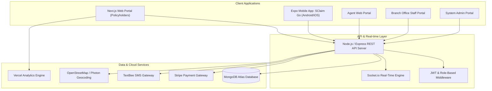

# 🛡️ SANASA General Insurance — SClaim Go
### Enterprise Motor Claim & Policy Management Ecosystem

[](https://sanasa-insurance-vehicle-damage-cla.vercel.app/)
[](https://expo.dev/accounts/gayathra45/projects/sclaim-go/builds/9159f4c0-c72a-47eb-8221-48521d8c8de5)
[](https://nextjs.org/)
[](https://expo.dev/)
[](https://nodejs.org/)
[](https://www.mongodb.com/)

---

## 🌐 Quick Access & Deployments

| Platform | Deployment Target | Access Link |
| :--- | :--- | :--- |
| **Official Web Portal** | Production Web Application | [Launch Web Portal](https://sanasa-insurance-vehicle-damage-cla.vercel.app/) |
| **Mobile App (APK)** | SClaim Go Android Standalone Build | [Download Android APK](https://expo.dev/accounts/gayathra45/projects/sclaim-go/builds/9159f4c0-c72a-47eb-8221-48521d8c8de5) |
| **API Backend** | Cloud Node.js / Express Server | Deployed on Render |
| **Database** | Distributed Cloud Cluster | MongoDB Atlas |

---

## 📌 Executive Overview

**SANASA SClaim Go** is an enterprise-grade digital insurance claims and vehicle policy management platform built for **SANASA General Insurance PLC**. It connects **Policyholders**, **Field Insurance Agents**, **Branch Officers**, and **System Administrators** into a unified, real-time, secure ecosystem.

The platform eliminates manual paperwork, accelerates accident claim reporting from days to minutes, enables digital driver authorization passes, provides intelligent claim status tracking, and features an integrated **Sanasa AI Assistant** for automated customer support.

---

## 🚀 Key System Features & Core Portals

### 1. 🚗 Policyholder Portal (Web & Mobile App)
- **Vehicle & Policy Portfolio**:
  - Live overview of all insured vehicles with authenticated Sri Lankan number plates.
  - One-click official policy cover note certificate generation and download.
  - Policy renewals with flexible payment options (One-Time & Multi-Installment plans via Stripe).
- **Accident Claim Submission**:
  - Guided step-by-step claim wizard with interactive GPS geolocation and OpenStreetMap / Photon geocoding.
  - Multi-angle damage photo capture with client-side image compression.
  - Immediate claim reference number generation and instant corporate SMS alert.
- **Track Claims & Digital Dossier**:
  - Real-time visual claim status tracker (Submission → Assessment → Investigation → Approval → Settlement).
  - Download official PDF Claim Dossier (`GET /api/claims/:claimNumber/report`).
- **Third-Party Driver Management & Access Control**:
  - Authorize third-party drivers to legally operate insured vehicles under policy coverage.
  - Generates secure, tokenized **Digital Driver Passes** (`/driver-access/[token]`) with NFC and mobile pass support.
  - **Branch-Approved Driver Termination**: Policyholders can request driver termination with reason tracking; upon branch officer sign-off, driver access across web and mobile is permanently blocked.
- **Interactive Sanasa AI Assistant**:
  - Ask natural language questions about claims status, vehicle coverage, branch hotlines, and policy documentation.

### 2. 📋 Field Insurance Agent Portal
- **On-Site Accident Inspection**: Field agents access assigned accident reports, inspect vehicle damages on-location, upload assessment notes, and verify estimated repair costs.
- **Digital Claims Portfolio**: Filter assigned claims, view incident locations on interactive maps, and submit instant field evaluations.
- **Direct Claim Chat**: Communicate with policyholders and branch claims officers directly inside the claim dossier.

### 3. 🏢 Regional Branch Office Staff Portal
- **Comprehensive Claims Pipeline**: Branch officers review claims, assign field agents, evaluate vehicle damages, verify police reports, approve claim amounts, or record rejection rationale.
- **Third-Party Driver Sign-Off Desk**: Review policyholder third-party driver registrations and termination requests with two-way corporate SMS notifications.
- **Policyholder & Vehicle Registry**: Manage vehicle renewals, update policy endorsements, and verify customer identities.
- **Branch Directory**: Island-wide routing and management across **27 regional branches** in Sri Lanka.

### 4. ⚙️ System Administrator Portal
- **Administrative Control**: User lifecycle management, role-based access control (RBAC), and staff branch assignments.
- **System Analytics & Audit Logs**: Real-time KPI dashboards, claim settlement volume, regional distribution, and activity logs.

---

## 🏗️ System Architecture



---

## 🛠️ Technology Stack

| Layer | Technology | Details |
| :--- | :--- | :--- |
| **Frontend Web** | Next.js 16 (App Router), React 19, TypeScript | Server & client components, responsive Tailwind CSS styling, Hugeicons |
| **Mobile App** | React Native, Expo SDK 57, Expo Router | TypeScript, EAS Cloud Build, native camera & location integration |
| **Backend API** | Node.js, Express.js | Modular REST architecture, Mongoose schemas, CORS, compression |
| **Database** | MongoDB Atlas | Distributed document database with atomic transactions & indexing |
| **Real-time** | Socket.io | Live claim chat, notification badges, and real-time status synchronization |
| **Payments** | Stripe API | Secure credit/debit card processing for policy renewals and registrations |
| **Notifications** | TextBee SMS Gateway API | Automated corporate SMS updates to policyholders, drivers, and agents |
| **Maps & Location** | OpenStreetMap, Photon, Nominatim | High-accuracy Sri Lanka geocoding, reverse geocoding, coordinates lookup |
| **Analytics** | Vercel Analytics | Web vitals, performance monitoring, audience insights |

---

## 🇱🇰 Regional Branch Coverage (27 Branches Island-Wide)

SANASA General Insurance serves customers across all 9 provinces in Sri Lanka:

| Province | Regional Branches |
| :--- | :--- |
| **Western** | Colombo Head Office, Negombo, Kalutara, Gampaha |
| **Southern** | Galle, Matara, Hambantota, Ambalangoda, Sooriyawewa |
| **Central** | Kandy, Matale, Nuwara Eliya |
| **North Western** | Kurunegala, Puttalam |
| **North Central** | Anuradhapura, Polonnaruwa |
| **Northern** | Jaffna, Kilinochchi, Mannar, Vavuniya, Mullaitivu |
| **Eastern** | Batticaloa, Trincomalee, Ampara |
| **Sabaragamuwa** | Ratnapura, Kegalle |
| **Uva** | Badulla, Moneragala |

---

## 💻 Local Development Setup

### Prerequisites
- **Node.js** (v18.x or v20.x recommended)
- **npm** or **yarn**
- **Git**
- **Android Studio / Expo Go** (optional, for mobile app testing)

---

### 1. Clone the Repository
```bash
git clone https://github.com/gayathra45/SanasaInsuarance.git
cd SanasaInsuarance
```

---

### 2. Backend Server Setup
```bash
cd backend
npm install
npm run dev
```
> The API server will start on `http://localhost:5000` (and `0.0.0.0:5000` for network device access).

---

### 3. Frontend Web Application Setup
```bash
cd ../frontend
npm install
npm run dev
```
> The Next.js application will launch on `http://localhost:3000`.

---

### 4. Mobile Application Setup (Expo)
```bash
cd ../mobile_app
npm install
npx expo start -c
```
> Scan the QR code with **Expo Go** on Android/iOS, or press `a` to launch in Android Emulator.

---

## 🔒 Security & Privacy Notice
This project follows strict security standards:
- Passwords are encrypted using **bcrypt** before database persistence.
- JWT tokens and session tokens are strictly scoped by user role (`PolicyHolder`, `Agent`, `OfficeStaff`, `Admin`, `ThirdPartyDriver`).
- Third-party driver tokens are single-purpose, revocable on demand, and validated on every API request.
- No sensitive credentials, production API secrets, or personal data are exposed in this repository.

---

## 📄 License & Credits
- **Client**: SANASA General Insurance PLC (Sri Lanka)
- **Project**: SClaim Go — Motor Claim & Policy Management Platform
- **Lead Developer**: Gayathra Samuditha ([@gayathra45](https://github.com/gayathra45))
