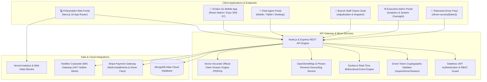
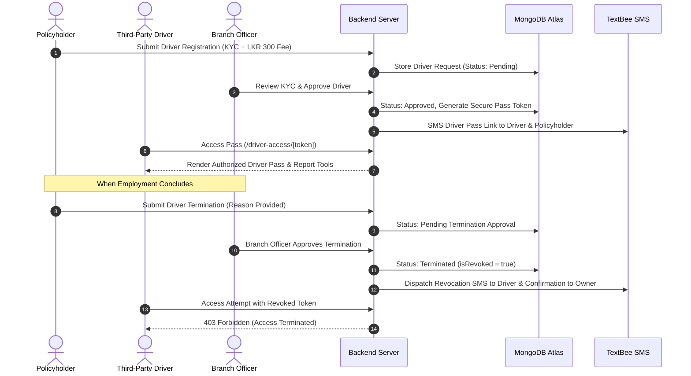

# 🛡️ SANASA General Insurance — SClaim Go
### Enterprise Motor Claim, Policy Renewal & Fleet Management Ecosystem

[](https://sanasa-insurance-vehicle-damage-cla.vercel.app/)
[](https://expo.dev/accounts/gayathra45/projects/sclaim-go/builds/9159f4c0-c72a-47eb-8221-48521d8c8de5)
[](https://nextjs.org/)
[](https://expo.dev/)
[](https://nodejs.org/)
[](https://www.mongodb.com/)
[](https://tailwindcss.com/)
[](https://vercel.com/analytics)
[](https://vercel.com/docs/speed-insights)
[](./LICENSE)

---

## 🌐 Quick Access & Live Deployments

| Platform / Service | Deployment Target | Access Link | Description |
| :--- | :--- | :--- | :--- |
| **Official Web Portal** | Production Web Application | [🚀 Launch Web Application](https://sanasa-insurance-vehicle-damage-cla.vercel.app/) | Next.js 16 App Router application deployed on Vercel with edge caching & Vercel Analytics |
| **Mobile App (APK)** | SClaim Go Android Standalone Build | [📲 Download Android APK](https://expo.dev/accounts/gayathra45/projects/sclaim-go/builds/9159f4c0-c72a-47eb-8221-48521d8c8de5) | Production installable APK generated via Expo Application Services (EAS) cloud pipeline |
| **Backend REST API** | Cloud Node.js / Express Server | Deployed on Render Cloud | Scalable REST API with real-time Socket.io bi-directional messaging engine |
| **Cloud Database** | Distributed Cloud Cluster | MongoDB Atlas | Enterprise document database with geographic indexing and automated backups |
| **Customer Hotline** | 24/7 Island-Wide Assistance | **`0725 575 575`** | Integrated emergency telephone hotline linked across all SMS and app interfaces |

---

## 📌 Executive Overview

**SANASA SClaim Go** is an enterprise-grade digital motor insurance claims, policy underwriting, and driver fleet governance platform engineered for **SANASA General Insurance PLC (Sri Lanka)**. The platform connects **Policyholders**, **Field Insurance Agents**, **Branch Officers**, and **System Administrators** into a synchronized, high-velocity operational ecosystem.

By eliminating manual paperwork and physical claim queues, **SClaim Go** accelerates motor claim lifecycle turnaround from weeks down to hours, provides real-time GPS accident location capture, enables authorized secondary driver onboarding with branch-controlled termination sign-offs, automates corporate SMS customer notifications, and integrates a custom conversational **Sanasa AI Assistant**.

---

## 🏛️ Comprehensive Architecture



---

## 🌟 Deep-Dive: Core System Functions & Capabilities

### 1. 🛡️ Third-Party Driver Authorization & Branch Termination Governance
Designed specifically for vehicle owners who employ private chauffeurs, commercial drivers, or family members. SClaim Go offers complete digital lifecycle management with official branch oversight:

- **Policyholder Driver Registration**:
  - Vehicle owners select which of their active registered vehicles to assign to the driver.
  - Driver KYC onboarding: Full Legal Name, National Identity Card (NIC), Mobile Phone Number, and Residential Address.
  - Mandatory document verification: Policyholder uploads driver's NIC (Front & Back) and Valid Driving Licence (Front & Back).
  - One-time flat fee of **LKR 300** covering all selected vehicles simultaneously, billed securely through Stripe Checkout.
- **Tokenized Digital Driver Pass (`/driver-access/[token]`)**:
  - Generates a cryptographically random, tamper-proof verification token with no passwords required for the driver.
  - The driver receives an automated SMS and can bookmark the specialized web pass.
  - Displays permitted vehicle specifications, policy coverage status, and a dedicated **"Report Accident"** tool for quick roadside submission.
- **"Manage Driver" Interactive Profile Card**:
  - Built directly into both the Grid View and List View of the Policyholder Vehicle Registry.
  - Clicking **Manage Driver** opens the live driver profile displaying:
    - Driver Full Name, NIC, Contact Number, and Residential Address.
    - System Pass Reference & Branch Approval Date.
    - Comprehensive list of all covered vehicles.
    - **"Copy Driver Pass Link"** clipboard button to instantly share or re-send the digital pass.
    - **"Terminate Driver Authorization"** danger action button.
- **Branch-Enforced Driver Termination Workflow**:
  - When an employment contract ends, a driver resigns, or access must be revoked, the policyholder initiates a termination request directly from the Web or Mobile app.
  - Form requires selecting a formal reason:
    - *Driver resigned / employment ended*
    - *Vehicle sold or transferred*
    - *Misconduct / policy violation*
    - *Owner revocation*
    - *Custom written justification*
  - The driver's status immediately transitions to `"Pending Termination Approval"`.
  - Regional Branch Officers review the termination submission in their management drawer.
  - **Upon Branch Approval**:
    - Pass status permanently updates to `"Terminated"`.
    - Token is revoked (`isRevoked: true`).
    - The driver is **100% locked out** of all web and mobile endpoints with an immediate HTTP `403 Forbidden` response.
    - Automated confirmation SMS messages are dispatched to both the vehicle owner and the driver.
  - **Upon Branch Rejection**: Status reverts to `"Approved"` with official branch notes delivered via SMS.



---

### 2. ⚡ Rapid Scene-of-Accident Claim Reporting
Shortens emergency reporting from hours to minutes directly at the scene of the collision:

- **Guided Step Wizard (Web & Mobile App)**:
  - Select insured vehicle with automatic policy status validation.
  - Enter incident date, time, and specify driver at the wheel (Policyholder or Authorized Driver).
  - Select granular damage categories: *Front Collision*, *Rear Impact*, *Side Dent*, *Windscreen / Glass Crack*, *Rollover*, *Underbody / Suspension*, *Flood / Water Damage*, *Fire / Mechanical*.
- **Interactive OpenStreetMap, Photon & Device GPS Geolocation**:
  - One-tap device GPS pin drops exact latitude and longitude coordinates.
  - Reverse-geocoding automatically converts GPS coordinates into readable Sri Lankan addresses (Town, District, Landmark).
  - Built-in search bar with autocomplete allows searching any village, town, or police station across Sri Lanka.
- **Client-Side Image Compression & Duplicate Detection**:
  - Upload forensic damage photos directly from device camera or photo gallery.
  - Client-side compression algorithm reduces multi-megabyte camera photos into lightweight, high-fidelity images before transmission, preventing network timeouts on 3G/4G rural networks.
  - Duplicate photo detection prevents redundant submissions.
- **Instant Official PDF Claim Dossier**:
  - Instant vector-accurate compilation of claim report with forensic damage photos, vehicle specs, incident timeline, driver details, and assessor notes.
  - Downloadable on demand via `GET /api/claims/:claimNumber/report`.

---

### 3. 🚦 End-to-End Claim Lifecycle & Live Status Tracking
An 8-stage interactive stepper keeps all stakeholders aligned in real time:

```
[1. Incident Reported] ➡️ [2. Branch Acknowledged] ➡️ [3. Assessor Dispatched] ➡️ [4. On-Site Inspection]
                                                                                            ⬇️
[8. Claim Settled & Closed] ⬅️ [7. Payment Dispatched] ⬅️ [6. Branch Final Approval] ⬅️ [5. Damage Estimated]
```

- **Live Stepper & Status Cards**:
  - Color-coded status badges and detailed audit timestamps for each transition.
  - Shows assigned Field Assessor profile, direct mobile contact number, and estimated arrival time.
- **Tri-Party Live Chat Desk (Socket.io)**:
  - Bi-directional instant chat channel tied to each specific Claim Reference Number (e.g., `CLM-2026-0042`).
  - Allows policyholders, field agents, and branch claims officers to exchange messages, repair estimates, and additional photo evidence.
  - Dynamic unread count badges, delivery timestamps, and sound alerts.

---

### 4. 🛵 Field Insurance Agent / Assessor Mobility Hub
Empowers on-site insurance assessors to perform their field duties on mobile, tablet, or laptop:

- **Assigned Claims Queue**: Real-time push notifications when a branch assigns a new accident claim.
- **Turn-by-Turn GPS Navigation (`MapRoute`)**: Built-in map view with route navigation from the agent's current coordinates straight to the accident location.
- **Digital On-Site Forensic Checklist**:
  - Structural bodywork inspection.
  - Mechanical, glass, and third-party property damage assessment.
  - Direct camera photo capture with damage level annotations.
  - Preliminary cost estimation and parts replacement recommendation.
- **Field Activity & TAT Analytics**: Tracks personal inspection performance, completed claims, and average turnaround time (TAT).

---

### 5. 🏢 Branch Office Staff & Claims Adjudication Desk
A centralized regional control room for claims officers across all 27 branches:

- **Geographic Routing & Claim Inbox**:
  - Claims automatically routed based on incident district or selected policyholder branch.
  - Filterable by urgency, claim status, and assigned assessor.
- **Smart Agent Dispatch**:
  - Evaluates regional agent availability, proximity, and current active inspection load.
  - One-click agent assignment with automated SMS dispatched to both agent and claimant.
- **Third-Party Driver & Vehicle Verification**:
  - Dedicated drawer for reviewing driver KYC identity documents (NIC, License).
  - Driver termination queue: review policyholder termination requests, view submitted justifications, and approve/reject with SMS dispatch.
- **Claim Finalization & Settlement Approvals**:
  - Compare agent estimates against standard Sanasa repair labor rates.
  - Authorize garage repair orders or direct bank settlement payments.

---

### 6. 💳 Smart Policy Renewal & Multi-Installment Engine
Automates premium calculation and flexible payment plans:

- **Dynamic Premium Valuation Engine**:
  - Calculates annual premium based on vehicle market value, engine capacity (CC), vehicle category (Car, Van, Dual Purpose, Bike, Heavy), and policy coverage options.
- **Flexible Payment Schedules**:
  - **One-Time Full Annual Payment**: 100% upfront with zero processing surcharge.
  - **2-Installment Plan**: 50% initial payment + 50% scheduled mid-term installment.
  - **4-Installment Plan**: Quarterly payments (25% down payment + 3 quarterly installments).
- **Stripe API Integration**:
  - Secure PCI-DSS compliant credit and debit card processing.
  - Instant Stripe Webhook listener updates policy validity in MongoDB and issues an official digital cover note.
  - Visual installment tracking cards with payment countdown alerts and quick-pay buttons.

---

### 7. 🤖 Sanasa AI Assistant (Conversational Customer Intelligence)
A built-in conversational AI assistant accessible on all pages of the web portal:

- **Natural Language Understanding**:
  - Query claim progress: *"What is the status of claim CLM-2026-0014?"*
  - Vehicle queries: *"What are my insured vehicles and when does my policy expire?"*
  - Guide assistance: *"How do I register a third-party driver?"* or *"How do I file a claim?"*
  - Branch directory lookup: *"Give me the contact number and address for Galle branch"*
- **Rich Action Responses**:
  - Embeds interactive buttons, direct links to claim tracking cards, PDF download triggers, and branch telephone dialers directly inside AI responses.

---

### 8. 🚗 Authentic Sri Lankan Vehicle Number Plate Engine
Enhances visual authenticity and user experience with realistic Sri Lankan license plates:

- **Standard Provincial Number Plates**:
  - Authentic styling with province code (e.g., `WP`, `CP`, `SP`, `NW`, `NC`, `NP`, `EP`, `SG`, `UP`).
  - Distinctive blue Sri Lanka flag emblem and `LK` country indicator.
  - Support for Modern 3-Letter formats (`WP CAB-1234`), Vintage 2-Letter formats (`18-9876`), and Special Government / Diplomatic series.
- **Dual Visual Modes**:
  - Clean Grid View cards with authentic plate badges, sum insured, and quick actions.
  - Compact List View for large commercial fleet owners managing multiple insured vehicles.

---

### 9. 📲 TextBee Corporate SMS Gateway Integration
Keeps users connected with automatic corporate SMS updates, referencing the 24/7 hotline (`0725 575 575`):

- **Incident Reporting Alerts**: Instant SMS confirmation with unique Claim Reference Number upon claim submission.
- **Assessor Dispatch Alerts**: SMS containing field agent name, phone number, and arrival update.
- **Driver Authorization Notices**: SMS dispatched to driver with their secure digital pass link.
- **Driver Termination Warnings**: Immediate SMS notification of pass revocation upon branch approval.
- **Claim Settlement Approvals**: Payout confirmation and garage repair order releases.
- **Authentication OTPs**: High-speed One-Time Passwords for secure registration and password resets.

---

### 10. 🌐 Trilingual Localization & Accessibility
- **Trilingual Support**:
  - English (`EN`)
  - Sinhala (`සිංහල`)
  - Tamil (`தமிழ்`)
- **Integrated Accessibility Suite**:
  - Dynamic font scale multiplier (Increase / Decrease text size on demand).
  - High-contrast visual modes for low-vision users.
  - Dyslexia-friendly typography toggle and semantic HTML screen-reader readiness.

---

## 🛠️ Complete Technology Stack

| Layer | Technologies Used | Key Responsibilities |
| :--- | :--- | :--- |
| **Web Frontend** | Next.js 16 (App Router), React 19, TypeScript | Server Components, Client Hydration, Layout Architecture |
| **Styling & Design System** | Tailwind CSS 4, Vanilla CSS, Hugeicons Core | Sanasa Corporate Design System, Authentic Number Plates |
| **Mobile Application** | React Native 0.86, Expo SDK 57, Expo Router | Cross-Platform Android/iOS build, Camera & GPS integration |
| **Backend REST API** | Node.js, Express.js | Modular Controller-Service-Repository REST endpoints |
| **Database & Cache** | MongoDB Atlas, Mongoose 8 | GeoJSON indexing, atomic transactions, schema validation |
| **Real-Time Engine** | Socket.io | Bidirectional WebSocket channels for Live Claim Chat |
| **Payment Gateway** | Stripe API & Stripe Webhooks | Card processing for renewals, installments & driver fees |
| **SMS Gateway** | TextBee SMS Gateway | SMS dispatch to Sri Lankan mobile networks (Mobitel, Dialog, etc.) |
| **Maps & Geocoding** | OpenStreetMap, Photon, Nominatim | Spatial coordinates, reverse-geocoding, address autocomplete |
| **Document Generation** | PDFKit / HTML Canvas | Vector-accurate official insurance claim dossiers & cover notes |
| **Web Analytics** | Vercel Analytics | Web Vitals, visitor tracking, and performance metrics |

---

## 🇱🇰 Regional Branch Coverage (27 Branches Island-Wide)

SANASA General Insurance maintains an island-wide branch network across all 9 provinces:

| Province | Regional Branches |
| :--- | :--- |
| **Western** | Colombo Head Office, Negombo, Kalutara, Gampaha |
| **Southern** | Galle, Matara, Hambantota, Ambalangoda, Sooriyawewa |
| **Central** | Kandy, Matale, Nuwara Eliya |
| **North Western** | Kurunegala, Puttalam |
| **North Central** | Anuradhapura, Polonnaruwa |
| **Northern** | Jaffna, Kilinochchi, Mannar, Vavuniya, Mullaitivu |
| **Eastern** | Batticaloa, Trincomalee, Ampara |
| **Sabaragamuwa** | Ratnapura, Kegalle |
| **Uva** | Badulla, Moneragala |

---

## 💻 Local Development & Installation

### Prerequisites
- **Node.js** (v18.x or v20.x LTS)
- **npm** (v9.x or v10.x)
- **Git**
- **Expo Go App** (available on Google Play Store & Apple App Store)

---

### Step 1: Clone the Repository
```bash
git clone https://github.com/gayathra45/SanasaInsuarance.git
cd SanasaInsuarance
```

---

### Step 2: Configure & Start Backend API Server
```bash
cd backend
npm install
npm run dev
```
> The API server boots up on `http://localhost:5000` (and `0.0.0.0:5000` for LAN access).

---

### Step 3: Configure & Start Web Application
```bash
cd ../frontend
npm install
npm run dev
```
> The Next.js portal launches at `http://localhost:3000`.

---

### Step 4: Configure & Launch Mobile Application
```bash
cd ../mobile_app
npm install
npx expo start -c
```
> The automated IP synchronizer (`update-ip.js`) links your machine IP. Scan the displayed QR code with the **Expo Go** app on your phone.

---

## 🔒 Security & Privacy Standards
- **Password Protection**: Passwords hashed using industry-standard **bcrypt** (salt rounds: 10).
- **Stateless RBAC**: Stateless JSON Web Tokens (JWT) scoped with role claims (`PolicyHolder`, `Agent`, `OfficeStaff`, `Admin`, `ThirdPartyDriver`).
- **Cryptographic Driver Tokens**: Third-party driver tokens are single-purpose, cryptographically random, revocable on demand, and validated on every API call.
- **Zero Plaintext Secrets**: No plaintext passwords, database credentials, or secret API keys are committed to this repository.

---

## 📄 License & Ownership
- **Software License**: This project is licensed under the **[MIT License](./LICENSE)**.
- **Client Organization**: SANASA General Insurance PLC (Sri Lanka)
- **Platform Name**: SClaim Go Motor Claim, Policy Renewal & Fleet Management System
- **Engineering Lead & Author**: Gayathra Samuditha ([@gayathra45](https://github.com/gayathra45))
